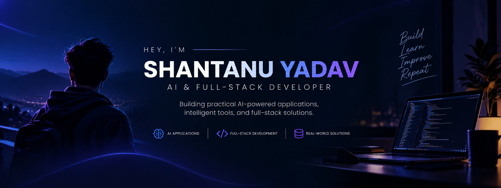

  

# 👋 Hey, I'm Shantanu Yadav

### AI & Full-Stack Developer | Data Science & AI Undergraduate

I build practical software that combines **AI, intelligent automation, and full-stack development** to solve real-world problems.

Currently pursuing B.Tech in Computer Science Engineering with a specialization in Data Science and Artificial Intelligence at Galgotias University.

- 🤖 Exploring LLM-powered applications, AI workflows, and document intelligence
- 🛠️ Building AI tools, web applications, and developer-focused products
- 📚 Strengthening my problem-solving and software engineering fundamentals
- 🎯 Interested in AI Engineering, Full-Stack Development, and Software Engineering opportunities

  
  
  

---

## 🚀 Featured Projects

### 🤖 [RowRocket — AI-Powered Document Intelligence](https://github.com/notorious404/RowRocket)

Extract structured tables from PDFs and DOCX documents, including scanned files, with OCR and AI-assisted reconstruction.

- 📄 Supports multi-page documents and complex tables
- 🔍 Uses Tesseract OCR for scanned PDFs
- 🧠 Integrates OpenAI for table reconstruction
- 📊 Generates structured outputs and downloadable reports

**Tech:** Python · Streamlit · OpenAI API · Tesseract OCR · pdfplumber · ReportLab

### 🛡️ [Sentinel AI — Intelligent Code Analyzer](https://github.com/notorious404/Sentinel-AI-)

An AI-powered code analysis platform that helps developers identify bugs, security concerns, performance bottlenecks, and potential improvements.

- 🔎 Analyzes code across multiple programming languages
- ⚡ Provides AI-assisted code improvements
- 📑 Generates downloadable code analysis reports
- 🗄️ Combines a Node.js backend with MySQL

**Tech:** JavaScript · Node.js · Express.js · MySQL · Gemini API

### 📑 [DiffPDF — Compare PDFs, Spot Every Difference](https://github.com/notorious404/DiffPDF-Compare-PDFs.-Spot-Every-Difference)

A document comparison application designed to make PDF differences easier to identify and review.

- ↔️ Side-by-side PDF comparison
- 🎯 Color-coded difference highlighting
- 📜 Synchronized scrolling
- 📄 Document analysis and report-generation capabilities

**Tech:** Python · HTML · CSS · JavaScript · PDF Processing

### 📊 [PDF Table Comparison App](https://github.com/notorious404/PDF-COMPARSION-APP-)

Compare extracted tables from two PDF documents and identify missing data, mismatched values, and structural changes.

- 🔍 Row-wise and column-wise comparisons
- 🧩 Table normalization for more consistent comparisons
- 📈 Multi-page table support
- 📄 Detailed PDF mismatch reports

**Tech:** Python · Streamlit · Pandas · Gemini API · ReportLab

### 📂 [Table Extraction App](https://github.com/notorious404/TABLE-EXTRACTION-APP)

A document-processing tool for extracting and reconstructing tables from PDF and DOCX files.

**Tech:** Python · OCR · Document Processing · AI Integration

---

## 🧰 Tech Stack & Tools

### 💻 Programming Languages

  

### 🌐 Web Development

  

### 🧠 AI, Data & Document Processing

  
  
  
  
  
  

### 🗄️ Databases & Developer Tools

  

*My toolkit evolves as I build and experiment with new technologies.*

---

## 📊 GitHub Overview

  
  

  

---

## 🤝 Let's Connect

I'm interested in building useful products, collaborating on interesting projects, and learning from other developers.

- 💼 [Connect with me on LinkedIn](https://www.linkedin.com/in/shantanu-yadav-896a4b298)
- 💻 [Explore my repositories](https://github.com/notorious404?tab=repositories)
- 📧 [Email me](mailto:yadu3904@gmail.com)

  <i>"Build with curiosity. Learn by creating. Improve with every iteration."</i>

